# 0004 — Development specification: Effect AI model adapters

Status: **proposed for acceptance**. This document defines an implementation plan and candidate
interface. It does not authorize public exports until accepted under the repository design gate.

## 1. Objective

Add a bidirectional, Effect-native bridge between the Synadia Agent Protocol adapter and Effect
v4's AI modules:

1. **Effect AI host adapter** — serve an existing `LanguageModel` implementation through an
   `AgentHost`.
2. **Remote agent model adapter** — present one discovered `AgentInfo` through Effect AI's
   `LanguageModel` interface.

The common text-streaming case should require Layer composition and ordinary configuration, not a
custom handler. Translation that loses roles, tools, attachments, response metadata, or protocol
queries must remain explicit.

```mermaid
flowchart LR
  Provider[Provider-specific Effect AI model]
  HostAdapter[Effect AI host adapter]
  Host[AgentHost]
  NATS[(NATS Core)]
  Caller[AgentClient]
  ModelAdapter[Remote agent model adapter]
  App[Effect AI application]

  Provider -->|LanguageModel| HostAdapter
  HostAdapter -->|PromptHandler| Host
  Host --> NATS
  NATS --> Caller
  Caller -->|AgentInfo + prompt Stream| ModelAdapter
  ModelAdapter -->|LanguageModel| App
```



## 2. Authority and dependency decision

The package continues to depend on exactly `effect@4.0.0-rc.111`. At this pin, Effect AI is part of
the `effect` package and is imported from `effect/unstable/ai`; it is not the standalone
`@effect/ai` package.

Verified pinned sources:

- `node_modules/effect/package.json:33` exports `./unstable/ai`.
- `node_modules/effect/src/unstable/ai/index.ts` exports `LanguageModel`, `Model`, `Prompt`,
  `Response`, `AiError`, `Tool`, `Toolkit`, and the related modules.
- `node_modules/effect/src/unstable/ai/LanguageModel.ts:764` defines `LanguageModel.make`, the
  provider-adapter constructor this bridge should use.
- `node_modules/effect/src/unstable/ai/LanguageModel.ts:667` defines the normalized provider input.
- `node_modules/effect/src/unstable/ai/Response.ts:308` defines the streaming output union.

The current standalone `@effect/ai@0.37.0` declares `effect@^3.22.0` as a peer. It must not be added
to this Effect v4 workspace.

Synadia Agent Protocol semantics remain controlled by
`docs/upstream/core-protocol-v0.3.0.md`. This bridge is local application integration; it does not
add protocol features or satisfy new conformance requirements.

## 3. Semantic mismatch ledger

The two models overlap, but neither is an encoding of the other.

| Concern | Effect AI | Synadia Agent Protocol v0.3 | Initial bridge decision |
|---|---|---|---|
| Prompt | Structured messages with roles and typed parts | One text prompt plus optional base64 attachments | Strict single-user-text profile |
| Streaming text | Start/delta/end parts | Ordered `response` chunks | Preserve delta order; host pump owns ack and terminator |
| Structured output | Provider receives a response schema | No response-format field | Reject in the remote-model adapter |
| Tools | Named tools, parameter schemas, results, approval, concurrency | No tool-call wire contract | Reject; do not reinterpret queries as tools |
| Caller query | No equivalent provider primitive | Agent can ask caller a text/attachment question | Unsupported in P1; dedicated handler in P2 |
| Attachments/files | Typed file/document/source parts with media information | Filename and base64 content; media type is not required | Advertise false / fail in P1 |
| Finish metadata | Reason, usage, provider response metadata | Terminator signals completion; no usage schema | Terminate normally; do not invent status chunks |
| Incremental provider state | `previousResponseId` and `incrementalPrompt` | No equivalent | Reject when requested |
| Errors | Closed `AiError` reason taxonomy | Protocol status plus transport/wire failures | Conservative explicit mapping |
| Cancellation | Effect interruption | Caller drops reply interest; host is not notified | Release locally; do not claim remote cancellation |

The strict profile is deliberately narrow. A caller that wants multi-message prompt rendering or
file conversion supplies a future prompt mapping policy rather than receiving a hidden formatting
choice.

## 4. Module design

The public seam should contain two deep modules. Translation helpers remain internal until there
are two real policies for the same seam.

```text
src/ai/
  EffectAiHost.ts        # LanguageModel -> AgentHost Layer
  RemoteAgentModel.ts    # AgentInfo/AgentClient -> LanguageModel Layer/Model
  internal/
    PromptMapping.ts     # strict prompt/request conversion
    ResponseMapping.ts   # ordered response-part conversion
    ErrorMapping.ts      # Agent errors <-> AiError / AgentFailure
    Limits.ts            # validated output counters
```

No `EffectAiClient` service is needed. `AgentClient` remains the protocol caller; the new adapter
only provides Effect AI's existing `LanguageModel` capability.

### 4.1 Effect AI host adapter

Candidate interface:

```ts
import type { Layer } from "effect"
import type { LanguageModel } from "effect/unstable/ai"

export interface Options extends Omit<AgentHostConfig, "handler" | "attachmentsOk"> {}

export const layer = (
  options: Options
): Layer.Layer<
  AgentHost,
  HostConfigError,
  Wire | LanguageModel.LanguageModel
>
```

`layer(options)` obtains the current `LanguageModel` during Layer acquisition and delegates
registration, heartbeats, bounded admission, reply ordering, and finalization to the existing
`layerHost` implementation.

P1 behavior:

1. Force `attachmentsOk: false` in advertised endpoint metadata.
2. Convert the accepted protocol request to `Prompt.make(request.prompt)`.
3. Invoke `model.streamText({ prompt, toolChoice: "none" })` only after the existing host pump has
   published its mandatory ack.
4. Map text deltas to `HandlerChunk.Text` in pull order.
5. Consume text start/end, reasoning, response metadata, and ordinary finish parts without
   publishing invented protocol chunks. Reasoning is never exposed as user-visible text.
6. Fail on tool calls/results, approval requests, files, document sources, URL sources, or an
   Effect AI error part. Silent content loss is forbidden.
7. Let `AgentHost` publish the error frame and exactly one terminator. The adapter does not publish
   directly to the reply subject.

Provider/model credentials and model-specific tuning remain owned by the provider's Layer. The
host adapter must not duplicate them in NATS configuration.

### 4.2 Remote agent model adapter

Candidate interface:

```ts
import type { Effect, Layer } from "effect"
import type { LanguageModel, Model } from "effect/unstable/ai"

export interface Limits {
  readonly maxResponseBytes: number
  readonly maxResponseChunks: number
}

export interface Options {
  readonly inactivityMs?: number
  readonly limits?: Partial<Limits>
  readonly responseAttachments?: "fail" | "ignore"
}

export const layer = (
  info: AgentInfo,
  options?: Options
): Layer.Layer<
  LanguageModel.LanguageModel,
  RemoteAgentModelConfigError,
  AgentClient
>

export const makeModel = (
  info: AgentInfo,
  options?: Options
): Effect.Effect<
  Model.Model<"nats-agent", LanguageModel.LanguageModel, AgentClient>,
  RemoteAgentModelConfigError
>
```

`layer` uses `LanguageModel.make` rather than hand-implementing Effect AI's service. This delegates
toolkit orchestration, response decoding, structured-output decoding, spans, and ID generation to
the pinned Effect implementation while keeping the provider hooks local.

The provider name is `nats-agent`. The default model name is
`{agent}/{owner}/{instanceId}`; applications may annotate it externally if they need a different
display label.

P1 provider-hook behavior:

- Accept only `responseFormat.type === "text"`, `tools.length === 0`, `toolChoice === "none"`, no
  `previousResponseId`, and no `incrementalPrompt`.
- Accept only a prompt containing exactly one user message made entirely of text parts.
- Publish the concatenated user text through `AgentClient.prompt`.
- Ignore the protocol's mandatory ack and unknown status values.
- Map each protocol response text to an Effect AI text delta in publication order.
- Emit exactly one text-start, text-end, and finish part around the observed deltas.
- Use an empty/unknown usage record; do not manufacture token counts.
- On protocol queries, fail typed and release reply interest in P1. Do not answer with a default.
- On response attachments, fail by default. `"ignore"` is an explicit opt-in permitted by the
  protocol's caller rules.
- Enforce total output byte and chunk limits for both streaming and `generateText` paths.

Proposed defaults are 16 MiB and 16,384 response chunks. They are local memory-safety limits, not
protocol limits, and remain configurable positive integers. `generateText` may collect only inside
these bounds; `streamText` remains pull-based and does not collect production output.

### 4.3 Discovery composition

Do not make discovery an implicit side effect of `layer(info)`. Applications that already hold an
`AgentInfo` get deterministic construction.

A later convenience constructor may select at Layer acquisition:

```ts
export interface Selector {
  readonly agent: string
  readonly owner: string
  readonly name?: string
  readonly instanceId?: string
}

export const layerDiscovered = (
  selector: Selector,
  options?: Options
): Layer.Layer<
  LanguageModel.LanguageModel | Model.ProviderName | Model.ModelName,
  DiscoveryFailed | AgentNotFound | AgentSelectionAmbiguous | RemoteAgentModelConfigError,
  AgentClient
>
```

Selection defaults to `require exactly one`. It must never choose the first response from an
unordered discovery window. Liveness can be required explicitly, but it is not proof that the
selected agent will accept the next prompt.

## 5. Prompt mapping policy

P1 includes one internal strict policy. It is intentionally not exposed as a service yet.

### Remote Effect AI prompt to protocol request

Accept:

- one user message;
- one or more text parts; and
- no toolkit, structured response format, file, image, audio, document, tool, assistant, or system
  parts.

Concatenate adjacent text parts without adding separators that were not present in the input.

Reject everything else with `AiError.InvalidUserInputError` or `AiError.UnsupportedSchemaError`
before `AgentClient.prompt` publishes. The error description names the unsupported feature without
logging prompt content.

### Protocol request to local Effect AI prompt

P1 constructs one user message from the protocol prompt. Endpoint metadata advertises
`attachments_ok: false`, so attachments are rejected by the host before model execution. Unknown
request-envelope fields remain available to protocol relays but are not injected into the model.

P2 may introduce two actual adapters at this seam:

- `StrictTextPromptMapping`; and
- an application-supplied structured renderer or attachment-aware mapping.

Only then should a public `PromptMapping` capability be introduced.

## 6. Response mapping policy

### Local Effect AI model to protocol chunks

| Effect AI stream part | Protocol behavior |
|---|---|
| `text-delta` | One response chunk with the exact delta |
| `text-start`, `text-end` | No chunk; ordering checked internally |
| reasoning start/delta/end | Consume without exposure |
| response metadata | Consume; add safe values to tracing only |
| finish: stop/length/other/unknown | Successful protocol termination |
| finish: content-filter | `AgentFailure(403)` then terminator |
| finish: error | `AgentFailure(500)` then terminator |
| error part | `AgentFailure(500)` then terminator |
| tool/file/source/approval content | `AgentFailure(500)`; unsupported by P1 mapping |

The adapter may observe finish reason and usage in spans, but must not invent a standard protocol
status or response field for them.

### Protocol chunks to remote Effect AI output

| Protocol chunk/outcome | Effect AI provider output |
|---|---|
| first ack | no output part |
| response text | `text-delta` with the same text |
| ordinary/unknown status | no output part |
| terminator | `text-end`, then `finish { reason: "stop" }` |
| response attachment | fail or explicitly ignore per option |
| query | P1 typed failure; P2 query handler |
| protocol violation | non-retryable conservative `AiError` |

The bridge cannot distinguish a natural stop from a model-specific stop reason because v0.3 does
not transmit that information. It reports `stop` only as the local interpretation of a successful
protocol terminator.

## 7. Error mapping

Effect AI's reason union is provider-oriented and its `NetworkError` requires HTTP request details.
The bridge must not fabricate HTTP records for NATS operations.

### Caller-side errors to `AiError`

| Agent caller error | Effect AI reason | Retry stance |
|---|---|---|
| local prompt/profile violation | `InvalidUserInputError` | no publish occurred; not retryable |
| remote 400 | `InvalidRequestError` | not retryable |
| remote 401/403 | `AuthenticationError` with conservative kind | not retryable |
| remote 404/409 | `UnknownError` with safe NATS metadata | not retryable |
| remote 429 | `UnknownError` until pre-ack rejection is retained in the error model | not automatically retryable |
| remote 500 | `UnknownError` | not automatically retryable |
| inactivity timeout, transport close, protocol violation | `UnknownError` with source tag | not automatically retryable |

This conservative mapping is intentional. Retrying an Agent Protocol prompt can run remote work a
second time, and the current caller error does not retain enough acceptance state to prove safety.

### Effect AI errors to protocol service errors

| Effect AI reason | Protocol code |
|---|---|
| invalid user input/request/tool configuration | 400 |
| content policy | 403 |
| rate limit | 429 |
| provider authentication, quota, network, internal, output, unknown | 500 |

Because the host ack is published before model execution, these errors occur after acceptance. The
code does not imply that retrying the original prompt is safe.

Interruption is never converted into either taxonomy. It remains interruption and executes the
existing scoped release/finalization path.

## 8. Configuration

Concrete `Options` constructors are the primary library interface. Optional `layerConfig` helpers
use Effect `Config` only for scalar startup data:

- agent/owner/name and agent-host registration settings;
- heartbeat, restart, inactivity, max-in-flight, byte, and chunk limits; and
- explicit attachment policy.

Provider credentials, endpoints, model IDs, and provider-specific tuning belong to the selected
Effect AI provider Layer. Prompt mapping functions, toolkits, query handlers, and attachment codecs
are capabilities or concrete values, not environment strings hidden inside this adapter.

All numeric values decode through positive finite schemas. Invalid config fails Layer acquisition;
it is never clamped silently.

## 9. Scope, streaming, and concurrency

- The host adapter adds no queue. `LanguageModel.streamText` is pulled by the sequential
  `PromptHandler` stream, which is pulled by the existing reply pump.
- The remote adapter adds no async-iterator bridge or queue. It maps the existing scoped
  `AgentClient.prompt` Stream directly.
- `AgentHost.maxInFlight` remains the only P1 host admission bound.
- Per-response byte/chunk counters are stream state, not retained global state.
- Interruption of the remote Effect AI stream releases the AgentClient reply subscription exactly
  once. It does not prove that remote model execution stopped.
- Neither adapter retries prompts. Reconnect, timeout, and late replies retain the existing Core
  NATS uncertainty.
- The host adapter must preserve one text-delta-at-a-time ordering. No concurrent mapping is needed
  in P1.

P2 query handling needs a separately owned bounded `FiberSet` or `FiberMap`, a positive concurrency
limit, exactly-once reply publication, and scope interruption. Protocol §7 permits multiple queries
in flight; a serial handler cannot be silently assumed.

## 10. Observability

Use stable operation names such as `EffectAiHost.handlePrompt`,
`RemoteAgentModel.generateText`, and `RemoteAgentModel.streamText`. Annotate spans with safe fields:

- protocol version;
- agent, owner, service instance ID, and advertised endpoint subject;
- mapping profile;
- observed chunk/byte counts; and
- terminal category.

Do not log prompt text, attachment contents, provider credentials, query replies, or raw unknown
metadata. Link provider spans below the host-prompt span; do not replace the provider's tracing.

## 11. Implementation slices and proof gates

Each slice is one red/green vertical seam.

### P0 — Effect AI import and constructor proof

- Compile against `effect/unstable/ai` at the exact pin.
- Construct a fake `LanguageModel` with `LanguageModel.make`.
- Do not add `@effect/ai` or a second Effect version.

### P1 — local model to agent host

- Red: a fake Effect AI model receives exactly one user-text prompt and its two deltas emerge as
  ack, two response chunks, and one terminator.
- Green: implement `EffectAiHost.layer` through the existing `layerHost` seam.
- Gates: provider failure after ack, content filter, unsupported part, interruption, max-in-flight,
  and exactly-once terminator.

### P2 — remote agent to Effect AI stream

- Red: a scripted AgentClient ack/two-response/terminator sequence becomes
  text-start/two-delta/text-end/finish.
- Green: implement `RemoteAgentModel.layer` with `LanguageModel.make`.
- Gates: strict prompt rejection before publish, byte/chunk saturation, attachments, query,
  timeout, malformed response, transport close, interruption, and exactly-once subscription
  release.

### P3 — non-streaming generation and Layer composition

- Prove `generateText` returns concatenated text and bounded content parts.
- Prove `generateObject`, tools, and incremental calls fail before publish under the strict profile.
- Prove `Model.ProviderName` and `Model.ModelName` are supplied by `makeModel`.
- Provide concrete-options and `ConfigProvider.fromUnknown` Layer tests.

### P4 — live and interoperability proof

- Run Effect AI model -> AgentHost -> native `nats-server` -> AgentClient -> remote Effect AI model.
- Assert exact text and terminal order without sleeps.
- Interrupt at model warm-up, first delta, and between final delta and terminator.
- Run an official Synadia caller against the Effect AI host and this remote model adapter against an
  official agent host. The Effect AI bridge must not alter vanilla wire behavior.

### P5 — optional richer mappings

Only after P1–P4:

- attachment/file codec with MIME and size policy;
- bounded query handler capability;
- application-defined multi-message prompt renderer;
- structured-output prompting profile; and
- tool/query extension research.

These are separate decisions. Query chunks are not Effect AI tool calls, and any new wire metadata
remains a negotiated local extension outside standard conformance.

## 12. Acceptance criteria

- [ ] Accept the two-module interface and strict P1 profile.
- [ ] Accept `effect/unstable/ai` as the only Effect AI dependency at the current pin.
- [ ] Accept conservative, non-retrying NATS-to-`AiError` mapping.
- [ ] Confirm or change the proposed response limits.
- [ ] Confirm response attachments fail by default.
- [ ] Confirm query handling and richer prompt mapping remain post-P1 capabilities.
- [ ] Add the public exports only after this specification is accepted and type-checked.

## 13. Known open design pressure

The largest mismatch is error semantics: Effect AI's network reason is HTTP-shaped, while NATS
timeouts and disconnects can leave prompt acceptance uncertain. P1 uses non-retryable
`UnknownError` with redacted NATS metadata. If upstream Effect AI gains a transport-neutral error
reason, revisit this mapping in an isolated compatibility change.

The second mismatch is prompt richness. A universal automatic formatter would be convenient but
would silently choose role delimiters, tool syntax, structured-output instructions, and attachment
representation. This specification deliberately keeps that policy out of the first bridge.
